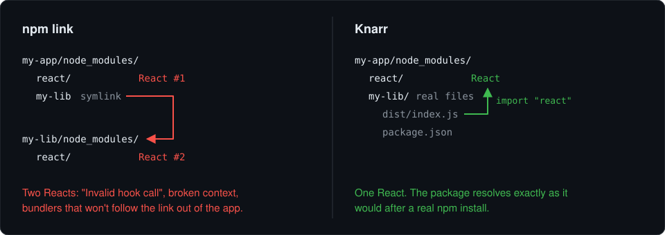
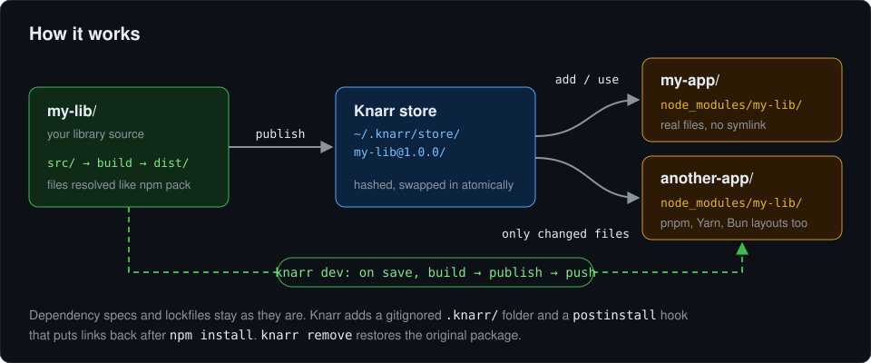

<p align="center">
  <picture>
    <source media="(prefers-color-scheme: dark)" srcset="https://raw.githubusercontent.com/oleg-kuibar/knarr/master/docs/assets/knarr-wordmark.png" />
    
  </picture>
</p>

<p align="center">
  <a href="https://www.npmjs.com/package/knarr"></a>
  <a href="https://www.npmjs.com/package/knarr"></a>
  <a href="https://github.com/oleg-kuibar/knarr/actions/workflows/ci.yml"></a>
  <a href="https://github.com/oleg-kuibar/knarr/actions/workflows/compat.yml"></a>
  <a href="https://github.com/oleg-kuibar/knarr/blob/master/LICENSE"></a>
  
</p>

# Knarr

**Test a local npm package in a real app, without `npm link`.**

Knarr copies the files your package would publish into the app's `node_modules/`, then keeps them in sync while you work. The app sees a normal installed package: one copy of React, no symlinks for the bundler to trip on, and no `file:` paths in `package.json` or the lockfile.

```bash
cd my-app
npx knarr use ../my-lib     # build, publish, and copy my-lib into my-app

cd ../my-lib
npx knarr dev               # on every save: rebuild and push to my-app
```

<p align="center">
  
</p>

## Why not `npm link`?

<p align="center">
  
</p>

A symlinked package resolves its imports from its own folder, so the app can end up with two copies of React (or any other peer dependency), and some bundlers won't follow the link outside the project. yalc copies files too, but it rewrites the app's dependency to a `file:` path. Knarr leaves the dependency spec alone.

If pnpm workspaces, `file:`, or pnpm's `injected` dependencies already fit your repo, use those. Knarr is for testing a package in an app it doesn't share a workspace with, exactly as it will be installed. See the [comparison](docs/comparison.md).

## How it works

<p align="center">
  
</p>

1. **`publish`** picks files the way `npm pack` does (`files`, `.npmignore`, `publishConfig.directory`) and copies them into a store at `~/.knarr/store/<name>@<version>/`.
2. **`add`** copies a package from the store into an app's `node_modules/` and registers the app. **`use`** does `publish` + `add` in one step.
3. **`push`** publishes and updates every registered app. Only files whose contents changed are copied.
4. **`dev`** watches the source, runs your build, and pushes after each change. `dev --all` does this for every package in a workspace, in dependency order.

## What it changes in your app

| | |
| --- | --- |
| `node_modules/<pkg>/` | Replaced with the published files. The original install is backed up, and `knarr remove` restores it. |
| `.knarr/` | Link state and the restore script. Added to `.gitignore`. |
| `package.json` | A `postinstall` hook that puts links back after `npm install` wipes them. It does nothing for teammates without Knarr. Dependencies are untouched. |
| Bundler config | Vite: adds the `knarr/vite` plugin. Next.js: adds the package to `transpilePackages`. Tailwind v4: adds an `@source` line. Each is skipped with instructions if the config is too complex to edit safely. |
| Lockfile | Untouched. |

## Compatibility

| | |
| --- | --- |
| Package managers | npm, pnpm (including its virtual store), Yarn 4 with `node-modules` or `pnpm` linker, Bun. Yarn PnP isn't supported because it has no `node_modules`. |
| Bundlers | Vite, Webpack, rspack, Next.js. Others pick up the changed files in `node_modules` on their own. |
| Platforms | macOS, Linux, Windows. |
| Node.js | 22.22 or newer. |

CI runs the test suite on all three platforms, and links a package into real npm, pnpm, Yarn, Bun, Vite, Webpack, rspack, and Next.js apps (`pnpm compat:smoke`).

## Install

```bash
npm install -g knarr     # or: pnpm add -g knarr
```

Or skip the install and run every command through `npx knarr`.

## Commands

| Command | What it does |
| --- | --- |
| `knarr use <path>` | Build, publish, and link a local package into this app. |
| `knarr dev [--all]` | Watch, build, and push on every change. |
| `knarr publish` / `knarr push` | Copy into the store / and update every linked app. |
| `knarr add <pkg>` / `knarr remove <pkg>` | Link from the store / restore the original install. |
| `knarr status`, `knarr list`, `knarr explain` | What is linked where, and why. |
| `knarr restore`, `knarr update`, `knarr rollback` | Re-apply links, pull the latest build, go back to an earlier build. |
| `knarr doctor`, `knarr check` | Diagnose setup problems; check a package's `exports` and files. |
| `knarr init`, `knarr migrate`, `knarr clean`, `knarr reset` | Set up an app, move from yalc, prune the store, undo everything. |

Every command takes `--dry-run`, `--json`, and `--verbose`. Full reference: [docs/commands.md](docs/commands.md).

## Coming from yalc

```bash
cd my-app
npx knarr migrate --from ../my-lib   # remove .yalc/, yalc.lock, and file:.yalc deps, then link my-lib
```

See [Migrating from yalc](docs/migrating-from-yalc.md).

## Documentation

- [Getting started](docs/getting-started.md)
- [Commands](docs/commands.md)
- [How it works](docs/how-it-works.md)
- [Bundlers](docs/bundlers.md) and [monorepos](docs/monorepo.md)
- [Troubleshooting](docs/troubleshooting.md) and [FAQ](docs/faq.md)
- [CI/CD](docs/ci-cd.md): Knarr is for local development; use canary releases in CI.
- [Programmatic API](docs/api.md) (experimental)
- [Contributing](CONTRIBUTING.md)

## Acknowledgments

Built on [chokidar](https://github.com/paulmillr/chokidar) (file watching), [citty](https://github.com/unjs/citty) (CLI), and [picomatch](https://github.com/micromatch/picomatch) (globs), bundled with [tsdown](https://tsdown.dev) and tested with [Vitest](https://vitest.dev).

## License

[MIT](LICENSE)
